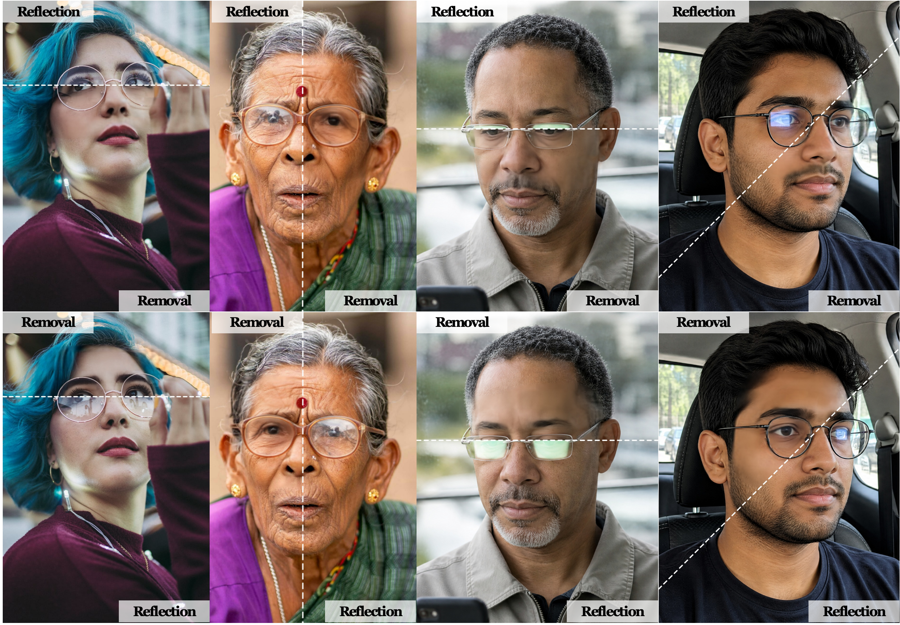

<div align="center">

<h1>OcuFlow</h1>

**Seeing Through the Glare: A Multi-Source Benchmark and Ocular-Adaptive Pixel MeanFlow for Eyeglass Reflection Removal**

[](https://arxiv.org/abs/2610.10703)
[](https://arxiv.org/pdf/2610.10703)
[](https://drive.google.com/file/d/1ca8_ulcuA6URjKy5syMvkGhsibbjV6NF/view?usp=sharing)
[](LICENSE)
[](https://github.com/NTU-AI4X/OcuFlow/stargazers)


</div>

OcuFlow is an ocular-adaptive pixel MeanFlow (pMF) framework for eyeglass reflection removal. It combines geometry-adaptive representations, one-step restoration, and native-resolution frequency-preserving synthesis to remove reflections while preserving facial and ocular details.

This repository provides three-stage training, batch inference, and single-image multi-face inference.

## Setup

Use Python 3.10+ and PyTorch 2.4+ with a CUDA build compatible with your GPU. BF16 requires a supported GPU.

```bash
cd OcuFlow
python -m pip install 'torch>=2.4'
python -m pip install -r requirements.txt
```

## Project Structure

```text
OcuFlow/
├── train.py                     # Three-stage training
├── infer.py                     # Single-image / batch inference
├── infer_single_multiface.py    # Multi-face inference
├── prepare_geometry.py          # Geometry preprocessing
├── prepare_grid.py              # Adaptive grid preprocessing
├── models/                      # Model components
├── weights/
│   └── checkpoint_best.pt
├── assets/
│   └── face_landmarker.task
└── examples/
    ├── test_mini/
    │   ├── pub_000654/
    │   │   ├── glare.png
    │   │   └── clean.png
    │   └── ...
    ├── output/
    └── predict/
```

Run the following commands from the project directory. The trained checkpoint and face detection asset must be available at the specified paths.

## Model Weights

Download the trained OcuFlow checkpoint:

**[Download checkpoint_best.pt (Google Drive)](https://drive.google.com/file/d/1ca8_ulcuA6URjKy5syMvkGhsibbjV6NF/view?usp=sharing)**

Place it under `weights/`:

```text
OcuFlow/
└── weights/
    └── checkpoint_best.pt
```

| File | Purpose |
|---|---|
| `checkpoint_best.pt` | Full trained OcuFlow model for inference |
| `pMF-B-16.pt` | Pretrained pMF initialization for training |
| `checkpoint_latest.pt` | Training state for resuming |

**Note:** `pMF-B-16.pt` cannot replace the full inference checkpoint. Keep `assets/face_landmarker.task` available for geometry preprocessing and online face detection.

## Quick Start

### Batch Inference

```bash
python infer.py \
  --input examples/test_mini \
  --checkpoint weights/checkpoint_best.pt \
  --output examples/output \
  --batch_size 8 \
  --preprocess_workers 4 \
  --prefetch_batches 3 \
  --save_workers 4 \
  --patch_backend gpu \
  --amp bf16 \
  --grid_solver fast
```

The script recursively finds `glare.png` and saves predictions as `examples/output/<sample>/pred.png`.

### Single-Image Inference

```bash
python infer.py \
  --input examples/test_mini/pub_000654/glare.png \
  --checkpoint weights/checkpoint_best.pt \
  --output examples/predict/pred.png
```

The result is saved to `examples/predict/pred.png`.

Only `glare.png` is required for inference. `clean.png` is an optional reference image.

### Multi-Face Inference

For an image containing multiple faces:

```bash
python infer_single_multiface.py \
  --input /path/to/group_photo.png \
  --checkpoint weights/checkpoint_best.pt \
  --output examples/predict/group_photo_pred.png \
  --max_faces 8 \
  --force_redetect \
  --model_asset_path assets/face_landmarker.task \
  --amp bf16
```

Faces share a fixed token budget. Standard inference reuses geometry caches when available and otherwise performs online detection.

Use `--force_redetect` to regenerate detections or `--strict_geometry_cache` for strict cache validation.

## Dataset

Our paper introduces **OcuBench**, a multi-source eyeglass reflection removal benchmark containing 10,280 synthetic pairs, 732 real-input pseudo-pairs, and 458 independent real-world test images.

The current training dataset is organized as follows:

```text
data/
├── train/
│   ├── syn_000001/
│   │   ├── glare.png
│   │   ├── clean.png
│   │   ├── prompt.txt
│   │   ├── mask.png
│   │   ├── eye_prior.png
│   │   └── face_meta.json
│   └── pub_000001/
│       └── ...
├── test_real/
│   └── pub_000223/
│       ├── glare.png
│       └── clean.png
└── test_syn/
    └── syn_000039/
        ├── glare.png
        └── clean.png
```

- `glare.png`: Input with eyeglass reflections.
- `clean.png`: Paired clean target or evaluation reference.
- `prompt.txt`: Optional accompanying text.
- `mask.png`: Required for samples selected for training-time validation.
- `eye_prior.png` and `face_meta.json`: Generated by geometry preprocessing.

By default, training holds out 16 `syn_` and 16 `pub_` samples for validation. Each group must contain more than 16 candidates, and selected samples need valid masks containing both masked and unmasked pixels.

Adjust the split using `--synthetic_prefix`, `--real_prefix`, `--val_synthetic_count`, and `--val_real_count`.

For datasets without validation masks, disable validation and early stopping with `--val_every 0 --early_stop_patience 0`.

## Preprocessing

Generate geometry priors and adaptive grid caches before training:

```bash
DATA=/home/liutao/video/RR/data
RUNS=outputs/train
GRID="$RUNS/grid_cache"

mkdir -p "$RUNS"

# Geometry preprocessing
python prepare_geometry.py \
  --dataset_root "$DATA" \
  --splits train test_real test_syn \
  --model_asset_path assets/face_landmarker.task

# Adaptive grid preprocessing
python prepare_grid.py \
  --data_root "$DATA" \
  --splits train test_real test_syn \
  --output "$GRID"
```

For training only, use `--splits train` in both commands. If using a merged `test` directory, replace `test_real test_syn` with `test`.

Regenerate caches after changing images or geometry settings. Use `prepare_geometry.py --overwrite` to replace existing geometry files.

## Training

OcuFlow uses three-stage training:

1. **pMF training:** Learn reflection removal with pixel MeanFlow.
2. **Renderer gate warm-up:** Initialize the detail-preserving renderer.
3. **Joint fine-tuning:** Jointly optimize the restoration pipeline.

```bash
python train.py \
  --data_root "$DATA" \
  --grid_cache "$GRID" \
  --output "$RUNS/final_full_nature" \
  --sampling natural \
  --init_weights weights/pMF-B-16.pt \
  --num_steps 60000 \
  --pmf_only_steps 45000 \
  --gate_warmup_steps 5000 \
  --renderer_ramp_steps 2000 \
  --batch_size 6 \
  --num_workers 4 \
  --precision bf16
```

Training saves `checkpoint_latest.pt`, validation-selected `checkpoint_best.pt` (when validation is enabled), and logs/visualizations in the output directory.

To resume training, replace `--init_weights` with:

```bash
--resume "$RUNS/final_full_nature/checkpoint_latest.pt"
```

If pretrained pMF weights are unavailable, omit `--init_weights` to train from random initialization.

For datasets without validation masks, append:

```bash
--val_every 0 --early_stop_patience 0
```

This disables validation, early stopping, and generation of `checkpoint_best.pt`.

## Hardware Notes

- **BF16 GPU:** Use `--precision bf16` for training and `--amp bf16` for inference.
- **Without BF16:** Use `--precision fp32` for training and `--amp off` for inference.
- **CPU inference:** Use `--device cpu --amp off --patch_backend pil`.

For all available options:

```bash
python train.py --help
python infer.py --help
python infer_single_multiface.py --help
```

## Citation

If you find OcuFlow useful for your research, please cite our paper:

```bibtex
@misc{liu2026seeing,
  title={Seeing Through the Glare: A Multi-Source Benchmark and Ocular-Adaptive Pixel MeanFlow for Eyeglass Reflection Removal},
  author={Tao Liu and Youwei Pang and Kailai Zhou and Jiaming Zuo and Hanqi Liu and Wei Ji and Peng-Tao Jiang and Xiaofeng Liu and Weisi Lin and Xiaoqi Zhao},
  year={2026},
  eprint={2610.10703},
  archivePrefix={arXiv},
  primaryClass={cs.CV},
  url={https://arxiv.org/abs/2610.10703}
}
```

